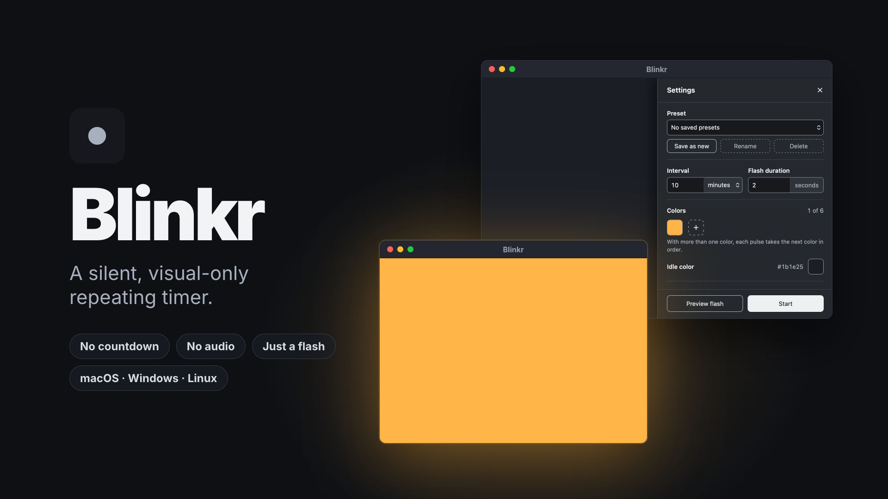
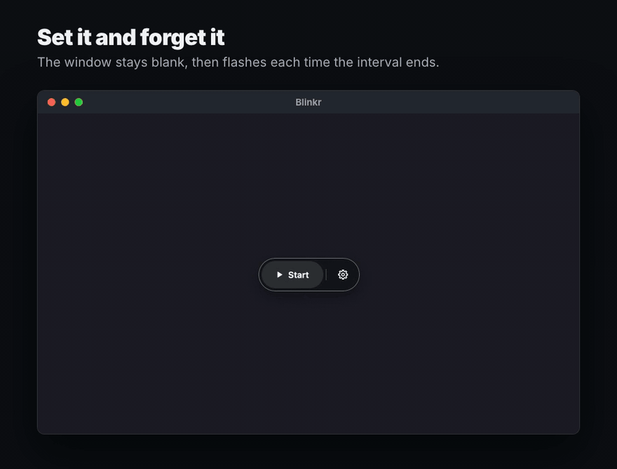
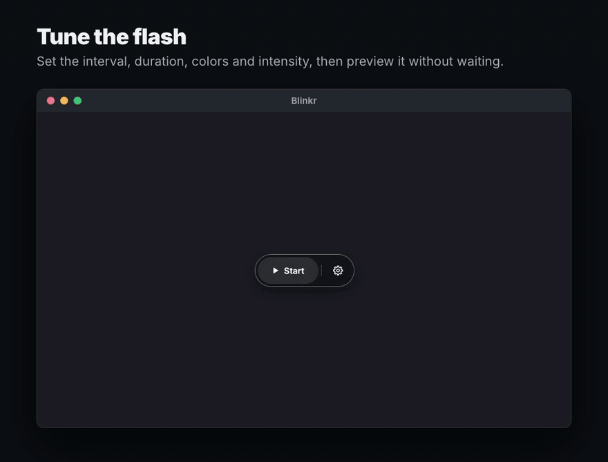
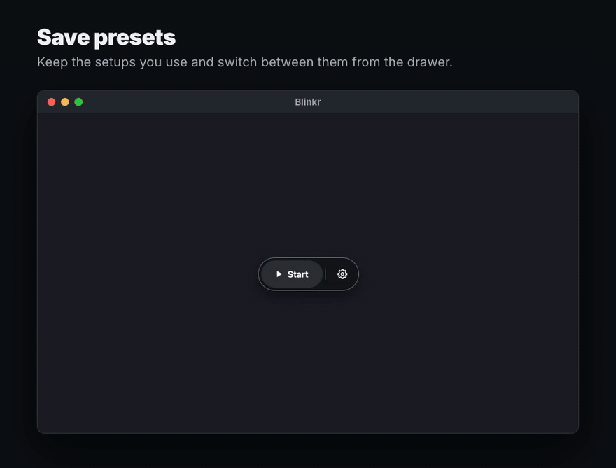
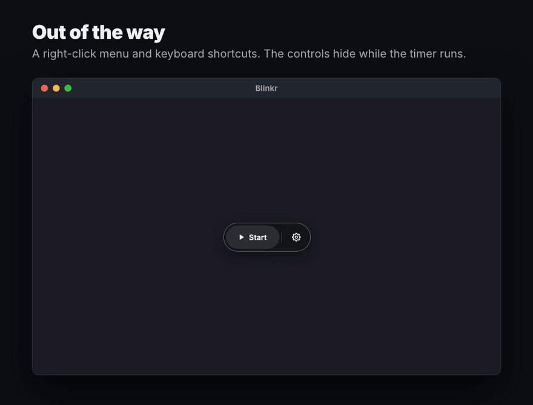

# Blinkr



A minimal, silent, visual-only repeating timer. Blinkr is a plain resizable window that stays blank and flashes a color on a set interval. There is no countdown display and no audio.

## See it in action

**Set it and forget it.** Start the timer, and the window stays blank until each interval ends in a flash.



**Tune the flash.** Set the interval, duration, colors, and intensity, then preview the flash without waiting.



**Save presets.** Keep the setups you use and switch between them from the drawer.



**Stay out of the way.** Use the right-click menu or the keyboard. The controls hide while the timer runs.



Defaults: a 2-second flash every 10 minutes, a smooth pulse at 60% intensity and 1 per
second, in amber on a dark idle color.

## Download

Installers for the latest build of `main` are on the
[latest release](https://github.com/codemonkey800/blinkr/releases/latest):

| Platform                        | File                                                                                                                                |
| ------------------------------- | ----------------------------------------------------------------------------------------------------------------------------------- |
| macOS (Apple Silicon and Intel) | [Blinkr-macos-universal.dmg](https://github.com/codemonkey800/blinkr/releases/latest/download/Blinkr-macos-universal.dmg)           |
| Windows 10 and 11, installer    | [Blinkr-windows-x64-setup.exe](https://github.com/codemonkey800/blinkr/releases/latest/download/Blinkr-windows-x64-setup.exe)       |
| Windows 10 and 11, portable     | [Blinkr-windows-x64-portable.exe](https://github.com/codemonkey800/blinkr/releases/latest/download/Blinkr-windows-x64-portable.exe) |
| Linux, any distro               | [Blinkr-linux-x86_64.AppImage](https://github.com/codemonkey800/blinkr/releases/latest/download/Blinkr-linux-x86_64.AppImage)       |
| Linux, Debian and Ubuntu        | [Blinkr-linux-amd64.deb](https://github.com/codemonkey800/blinkr/releases/latest/download/Blinkr-linux-amd64.deb)                   |

The installers are not code-signed, so the first launch shows a warning:

- **macOS:** open the DMG and drag Blinkr to Applications. On first launch, choose Done,
  then go to System Settings, Privacy & Security, and click Open Anyway.
- **Windows:** when SmartScreen appears, click More info, then Run anyway. The portable
  exe runs without installing, and keeps its settings in your user AppData folder.
- **Linux AppImage:** mark it executable with `chmod +x`, then run it.

## Usage

### Control bar

The window shows a small control bar with a Start/Stop button and a settings gear. It is
always visible while stopped. While running, it appears only after pointer movement, a
click, or Tab, and fades out when idle. It never shows a time.

Click the gear to open the settings drawer. Click outside the drawer, press Escape, or
start the timer to close it.

### Keys

| Key      | Action                                                               |
| -------- | -------------------------------------------------------------------- |
| `S`      | Open settings.                                                       |
| `Space`  | Start or stop the timer.                                             |
| `P`      | Preview one flash with the current look. It never changes the timer. |
| `Escape` | Close the menu, then the drawer. With both closed, leave fullscreen. |

Keys are ignored while typing in a field, and while a button has focus when it handles
the key itself. Escape works everywhere.

### Right-click menu

Right-click the window for Open settings, Start or Stop timer, Preview flash, and a Keep on
top toggle. Text fields in the drawer keep the native menu for copy and paste.

### Presets

A preset saves the timing and look: interval, flash duration, colors, style, intensity,
rate, and idle color. It does not save window modes or the hotkey. The picker is at the top
of the drawer. Use it to save the current values as a new preset, update or rename the
selected one, or delete it. Up to 20 presets are kept. Applying a preset while running
restarts the timer from now. Presets are stored apart from settings and persist between
launches.

### Window modes

- **Always on top:** keeps the window above others. Also in the right-click menu.
- **Borderless:** removes the title bar and frame. Drag anywhere on the window to move it,
  past a 4 px threshold so clicks still work.
- **Fullscreen:** fills the screen. Escape leaves it, and the stored setting follows.

### Photosensitivity

Rapid, high-intensity flashing can trigger seizures in people with photosensitive
epilepsy. The flash rate is capped at 3 per second, and the drawer shows a warning beside
the style, intensity, and rate controls. The warning becomes a stronger one for rates above
2 per second and for hard blinks above 70% intensity. Keep the defaults gentle, use a
smooth pulse, and stop if anyone feels unwell.

## Platform notes

- **Global hotkey:** off by default. Pick one of three accelerators in the drawer. If another
  app owns it, the drawer says it couldn't register. Linux under Wayland may refuse global
  shortcuts altogether.
- **Borderless resize:** some Linux window managers can't resize a borderless window from
  its edges. Turn borderless off to resize, or use the window manager's own resize.

## Development

```sh
pnpm install --frozen-lockfile
pnpm desktop:dev
```

See [docs/development.md](docs/development.md) for prerequisites, checks, and builds. The
original product spec is in [docs/spec.md](docs/spec.md).
