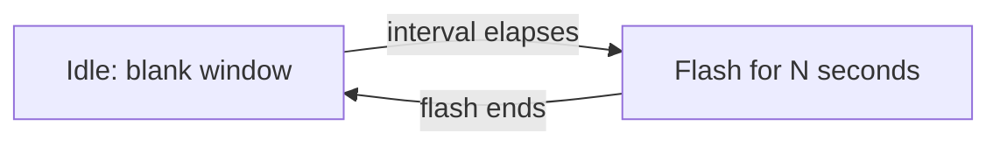

# Blinkr

A minimal, silent, visual-only repeating timer. Blinkr is a plain resizable window that stays blank and flashes a color on a set interval. There is no countdown display and no audio.

## Overview

Blinkr is a super simple repeating countdown timer that works as a visual cue:

- A simple window that can be resized.
- The window flashes for a couple of seconds every X amount of time.
- The timer itself is invisible. Only the flash is seen, then the cycle repeats.
- No audio, visual flashing only.
- The flash color(s) are user-selectable.
- The flash intensity is adjustable.
- Runs on Windows, macOS, and Linux.

## How it works

1. The user sets an interval (for example, every 10 minutes).
2. The user starts the timer. The window sits blank (idle color).
3. When the interval elapses, the window flashes for a short, configurable duration.
4. The flash ends, the countdown restarts automatically, and the cycle repeats until stopped.



## Requirements

### Core

- **Window:** A normal, freely resizable desktop window. Flashing fills the whole window.
- **Repeating timer:** Runs continuously, restarting after each flash, until the user stops it.
- **Configurable interval:** The user sets how long to wait between flashes (seconds, minutes, hours).
- **Invisible countdown:** No remaining-time readout is shown while the timer runs.
- **Flash duration:** The flash lasts a couple of seconds by default, and the length is configurable.
- **Silent:** No audio of any kind.

### Customization

- **Color(s):** The user picks one or more flash colors. With several colors, the flash cycles through them.
- **Intensity:** The user adjusts how strong the flash is. Intensity could control:
  - Brightness or opacity of the flash color.
  - Flash rate (how fast it pulses on and off).
  - Hard on/off strobing versus a soft fade in and out.
- **Idle color:** The color shown between flashes. Default is dark or neutral.

### Settings UI

- Interval, flash duration, color(s), and intensity can all be changed.
- Start and stop control.
- Settings are hidden or tucked away so the window stays clean while running (for example, a collapsible panel, a hotkey, or a right-click menu).
- Settings persist between launches.

### Nice to have

- Always-on-top option, so the flash is visible over other windows.
- Borderless or fullscreen mode.
- Global hotkey to start or stop.
- Multiple saved presets.
- Flash preview in the settings so intensity and color can be tuned without waiting for the interval.

## Non-goals

- Audio alerts.
- A visible countdown or clock display.
- Task, calendar, or notification-center integration.

## Safety note

Rapid, high-intensity flashing can trigger photosensitive seizures. Defaults should be gentle (slow pulse, moderate intensity), and a short warning should appear near the intensity control.

## Platforms and tech stack

Built with [Tauri](https://tauri.app), with a web frontend and a Rust backend. Windows, macOS, and Linux are all supported from the start. Features must work on every platform, or be clearly marked as platform-specific.

Platform-sensitive items to verify early:

- Always-on-top and borderless or fullscreen behavior.
- Global hotkeys (Wayland on Linux has limits).
- Smooth rendering of fast flashes across webview engines (WebView2, WKWebView, WebKitGTK).

## Open questions

- Should flashing be a hard blink or a smooth pulse by default?
- Should the settings stay on screen at all, or only appear on demand?

## Status

Blinkr works as a desktop app. The timer, flash surface, settings drawer, saved presets,
always-on-top, borderless and fullscreen modes, and an optional global hotkey are all
implemented. Settings and presets persist between launches, and the app always starts
stopped. There is no audio and no countdown or clock readout anywhere.

Defaults: a 2-second flash every 10 minutes, a smooth pulse at 60% intensity and 1 per
second, in amber on a dark idle color.

## Usage

### Control bar

The window shows a small control bar with a Start/Stop button and a settings gear. It is
always visible while stopped. While running, it appears only after pointer movement, a
click, or Tab, and fades out when idle. It never shows a time.

Click the gear to open the settings drawer. Click outside the drawer, press Escape, or
start the timer to close it.

### Keys

| Key      | Action                                                               |
| -------- | -------------------------------------------------------------------- |
| `S`      | Open settings.                                                       |
| `Space`  | Start or stop the timer.                                             |
| `P`      | Preview one flash with the current look. It never changes the timer. |
| `Escape` | Close the menu, then the drawer. With both closed, leave fullscreen. |

Keys are ignored while typing in a field, and while a button has focus when it handles
the key itself. Escape works everywhere.

### Right-click menu

Right-click the window for Open settings, Start or Stop timer, Preview flash, and a Keep on
top toggle. Text fields in the drawer keep the native menu for copy and paste.

### Presets

A preset saves the timing and look: interval, flash duration, colors, style, intensity,
rate, and idle color. It does not save window modes or the hotkey. The picker is at the top
of the drawer. Use it to save the current values as a new preset, update or rename the
selected one, or delete it. Up to 20 presets are kept. Applying a preset while running
restarts the timer from now. Presets are stored apart from settings and persist between
launches.

### Window modes

- **Always on top:** keeps the window above others. Also in the right-click menu.
- **Borderless:** removes the title bar and frame. Drag anywhere on the window to move it,
  past a 4 px threshold so clicks still work.
- **Fullscreen:** fills the screen. Escape leaves it, and the stored setting follows.

Both modes are no-ops in a plain browser.

### Photosensitivity

Rapid, high-intensity flashing can trigger seizures in people with photosensitive
epilepsy. The flash rate is capped at 3 per second, and the drawer shows a warning beside
the style, intensity, and rate controls. The warning becomes a stronger one for rates above
2 per second and for hard blinks above 70% intensity. Keep the defaults gentle, use a
smooth pulse, and stop if anyone feels unwell.

## Platform notes

- **Global hotkey:** off by default. Pick one of three accelerators in the drawer. If another
  app owns it, the drawer says it couldn't register. Linux under Wayland may refuse global
  shortcuts altogether. In a plain browser the option reports that it is desktop-only.
- **Borderless resize:** some Linux window managers can't resize a borderless window from
  its edges. Turn borderless off to resize, or use the window manager's own resize.
- **Background throttling:** the app asks the webview not to throttle timers while hidden,
  but that only takes effect on macOS 14 and later. Elsewhere, scheduling uses absolute
  deadlines, so flashes stay on time and the timer does not drift.

### Native permissions

The main window is granted exactly these, in `src-tauri/capabilities/main.json`:

- `core:window:allow-is-fullscreen`
- `core:window:allow-set-always-on-top`
- `core:window:allow-set-decorations`
- `core:window:allow-set-fullscreen`
- `core:window:allow-start-dragging`
- `global-shortcut:allow-is-registered`
- `global-shortcut:allow-register`
- `global-shortcut:allow-unregister`
- `store:allow-get`
- `store:allow-load`
- `store:allow-save`
- `store:allow-set`

The app has no network access, and its content security policy is strict.

### Still unverified

- Windows and Linux builds, which have not been compiled or run.
- The remote GitHub Actions matrix, which has not run.
- Native visual inspection on macOS. Accessibility automation is denied here, so only the
  browser rendering was inspected.
- Wayland behavior, including the global hotkey.
- Real Tauri behavior for dragging, fullscreen, and hotkey registration. Tests use mocks.

## Developer setup

### Pinned tools

- **Node.js:** 24.15.0
- **pnpm:** 9.15.9
- **Rust:** 1.99.1, including `rustfmt` and Clippy

Check the installed versions before continuing:

```sh
node --version
pnpm --version
rustc --version
cargo --version
```

Install the pinned pnpm version with Corepack after installing Node:

```sh
corepack enable
corepack prepare pnpm@9.15.9 --activate
```

For a new Rust installation, use [rustup](https://rustup.rs/):

```sh
rustup toolchain install 1.99.1 --profile minimal --component rustfmt --component clippy
rustup default 1.99.1
```

The committed `rust-toolchain.toml` selects the same toolchain for this repository.
On this Mac, the verified alternative is Homebrew Rust: `brew install rust` provides
`/opt/homebrew/bin/cargo` and `/opt/homebrew/bin/rustc` 1.99.1, with rustfmt 1.10.0
and Clippy 0.1.99. This path works without rustup; do not replace an existing matching
installation. Confirm the version output above after installing, because Homebrew
upgrades independently of this project's pin.

### Platform prerequisites

- **macOS:** Install Xcode and its command-line tools (`xcode-select --install`). Hosted
  macOS CI already supplies Xcode.
- **Windows:** Install Microsoft C++ Build Tools with the MSVC toolchain and Windows SDK,
  plus the [Microsoft Edge WebView2 Runtime](https://developer.microsoft.com/microsoft-edge/webview2/).
  Hosted Windows CI supplies MSVC, the Windows SDK, and WebView2.
- **Ubuntu/Debian Linux:** Install the Tauri v2 build prerequisites:

  ```sh
  sudo apt-get update
  sudo apt-get install --yes \
    build-essential file libwebkit2gtk-4.1-dev libgtk-3-dev libssl-dev \
    libayatana-appindicator3-dev librsvg2-dev libxdo-dev pkg-config
  ```

See the official [Tauri prerequisites](https://v2.tauri.app/start/prerequisites/),
[frontend configuration](https://v2.tauri.app/start/frontend/), and
[development guide](https://v2.tauri.app/develop/) for platform details.

### Install and develop

Install exactly what the committed lockfile declares:

```sh
pnpm install --frozen-lockfile
```

Use frontend-only development when browser rendering is enough:

```sh
pnpm dev
```

Open `http://localhost:1420` in a browser. The port is intentionally fixed and strict;
stop the process using port 1420 before starting another frontend or desktop session.

Use desktop development to start Vite and the native Tauri window together:

```sh
pnpm desktop:dev
```

Desktop compilation is platform-native: build Windows on Windows, macOS on macOS, and
Linux on Linux. It is not a cross-platform packaging workflow.

### Quality checks and builds

Run the same frontend checks used by CI:

```sh
pnpm format:check
pnpm lint
pnpm typecheck
pnpm build
pnpm test
```

`format:check` checks Prettier formatting; `pnpm format` applies formatting fixes.
`lint` runs ESLint, `typecheck` checks the frontend and build configuration with
TypeScript, and `build` typechecks and compiles the production frontend with Vite.
`test` runs the infrastructure tests against the resolved Vite configuration, Tauri
paths, built assets, and configured icons.

`pnpm build` recreates `dist`, which the infrastructure tests and Tauri's Rust build
read. Run it before `pnpm test` or Cargo commands in a clean checkout.

Run native checks after a frontend build:

```sh
cargo fmt --manifest-path src-tauri/Cargo.toml --all -- --check
cargo clippy --manifest-path src-tauri/Cargo.toml --all-targets --locked -- -D warnings
cargo test --manifest-path src-tauri/Cargo.toml --locked
pnpm tauri build --no-bundle --ci
```

The Cargo commands check Rust formatting, reject Clippy warnings, and run Rust tests,
respectively. `pnpm desktop:build` invokes the Tauri production build with the default
platform bundles; `pnpm tauri` exposes the Tauri CLI directly.

`pnpm tauri build --no-bundle --ci` performs a production native compilation without
making an installer. To create the macOS application bundle locally, run:

```sh
pnpm tauri build --bundles app --ci
```

Launch that production bundle independently of the Vite server:

```sh
open src-tauri/target/release/bundle/macos/Blinkr.app
```

Drag a window edge or corner to verify resizing manually. The production application
embeds `dist` and does not need the development server on port 1420.

The macOS output is `src-tauri/target/release/bundle/macos/Blinkr.app`; analogous native
outputs live below `src-tauri/target/release/bundle/` on their respective hosts. These
builds are unsigned: macOS Gatekeeper and platform signing policies can block normal
distribution. This repository does not publish installers, releases, tags, or signing
artifacts. See the official [Tauri distribution guide](https://v2.tauri.app/distribute/)
for release signing and packaging guidance.

Both `pnpm-lock.yaml` and `src-tauri/Cargo.lock` are part of the reproducible build
contract. Keep them committed and use `--frozen-lockfile` for pnpm plus `--locked` for
Cargo commands; update either lockfile only when intentionally changing dependencies.

CI defines frontend quality checks and production native compilation on macOS,
Windows, and Ubuntu. Local macOS checks do not establish that Windows/Linux builds
or the remote GitHub Actions matrix have passed; those results remain unverified
until the workflow runs on GitHub.
