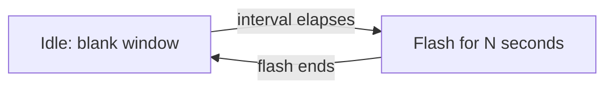

# Blinkr product spec

The original spec Blinkr was built from. Everything here is implemented, so treat it as
design history. The [README](../README.md) describes how the app behaves today.

## Overview

Blinkr is a super simple repeating countdown timer that works as a visual cue:

- A simple window that can be resized.
- The window flashes for a couple of seconds every X amount of time.
- The timer itself is invisible. Only the flash is seen, then the cycle repeats.
- No audio, visual flashing only.
- The flash color(s) are user-selectable.
- The flash intensity is adjustable.
- Runs on Windows, macOS, and Linux.

## How it works

1. The user sets an interval (for example, every 10 minutes).
2. The user starts the timer. The window sits blank (idle color).
3. When the interval elapses, the window flashes for a short, configurable duration.
4. The flash ends, the countdown restarts automatically, and the cycle repeats until stopped.

## Requirements

### Core

- **Window:** A normal, freely resizable desktop window. Flashing fills the whole window.
- **Repeating timer:** Runs continuously, restarting after each flash, until the user stops it.
- **Configurable interval:** The user sets how long to wait between flashes (seconds, minutes, hours).
- **Invisible countdown:** No remaining-time readout is shown while the timer runs.
- **Flash duration:** The flash lasts a couple of seconds by default, and the length is configurable.
- **Silent:** No audio of any kind.

### Customization

- **Color(s):** The user picks one or more flash colors. With several colors, the flash cycles through them.
- **Intensity:** The user adjusts how strong the flash is. Intensity could control:
  - Brightness or opacity of the flash color.
  - Flash rate (how fast it pulses on and off).
  - Hard on/off strobing versus a soft fade in and out.
- **Idle color:** The color shown between flashes. Default is dark or neutral.

### Settings UI

- Interval, flash duration, color(s), and intensity can all be changed.
- Start and stop control.
- Settings are hidden or tucked away so the window stays clean while running (for example, a collapsible panel, a hotkey, or a right-click menu).
- Settings persist between launches.

### Nice to have

- Always-on-top option, so the flash is visible over other windows.
- Borderless or fullscreen mode.
- Global hotkey to start or stop.
- Multiple saved presets.
- Flash preview in the settings so intensity and color can be tuned without waiting for the interval.

## Non-goals

- Audio alerts.
- A visible countdown or clock display.
- Task, calendar, or notification-center integration.

## Safety note

Rapid, high-intensity flashing can trigger photosensitive seizures. Defaults should be gentle (slow pulse, moderate intensity), and a short warning should appear near the intensity control.

## Platforms and tech stack

Built with [Tauri](https://tauri.app), with a web frontend and a Rust backend. Windows, macOS, and Linux are all supported from the start. Features must work on every platform, or be clearly marked as platform-specific.

Platform-sensitive items to verify early:

- Always-on-top and borderless or fullscreen behavior.
- Global hotkeys (Wayland on Linux has limits).
- Smooth rendering of fast flashes across webview engines (WebView2, WKWebView, WebKitGTK).

## Resolved questions

- **Hard blink or smooth pulse by default?** Smooth pulse.
- **Settings on screen or on demand?** On demand, through a control bar that fades while the timer runs.
